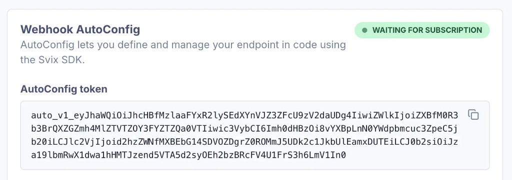

<p align="center">
  <a href="https://www.svix.com">
    
  </a>
</p>

# Subscribe Webhook Endpoint with AutoConfig - GitHub Action

This GitHub action configures a webhook endpoint using [Webhooks AutoConfig](https://docs.svix.com/receiving/webhooks-autoconfig).

AutoConfig lets you declare your endpoint configuration in code, so it's always in sync with your code, without any manual changes in the webhooks management UI.

For more information, check out [the docs](https://docs.svix.com/receiving/webhooks-autoconfig).

## Inputs

### `autoconfig-token`

**Required**
Your [AutoConfig token](https://docs.svix.com/receiving/webhooks-autoconfig#get-the-autoconfig-token) from the webhooks management portal (`auto_v1_...`).

### `endpoint`

**Required**
A JSON object describing the endpoint configuration ([`EndpointIn`](https://api.svix.com/docs#tag/Endpoint/operation/v1.endpoint.create)).

Supported fields include `url`, `filterTypes`, `description`, `disabled`, `channels`, `headers`, `metadata`, `uid`, `version`, and `throttleRate`.

Example:

```json
{
  "url": "https://api.us.example.com/webhooks/acme",
  "filterTypes": ["invoice.paid", "user.created"]
}
```

## Outputs

### `endpoint`

The configured endpoint ([`EndpointOut`](https://api.svix.com/docs#tag/Endpoint/operation/v1.endpoint.get)) as a JSON string.

## Usage

Before using this action, [create an endpoint](https://docs.svix.com/receiving/webhooks-autoconfig#create-an-endpoint) using AutoConfig and copy the token from the webhooks management portal:



Add the following step to your CI/CD pipeline:

```yaml
- name: Subscribe Webhook Endpoint with AutoConfig
  uses: svix/webhooks-autoconfig-action@v1.0.0
  with:
    autoconfig-token: ${{ secrets.AUTO_CONFIG_TOKEN }}
    endpoint: |
      {
        "url": "https://api.us.example.com/webhooks/acme",
        "filterTypes": ["invoice.paid", "user.created"]
      }
```

## Documentation

- [Webhooks AutoConfig guide](https://docs.svix.com/receiving/webhooks-autoconfig)
- [Svix documentation](https://docs.svix.com)
